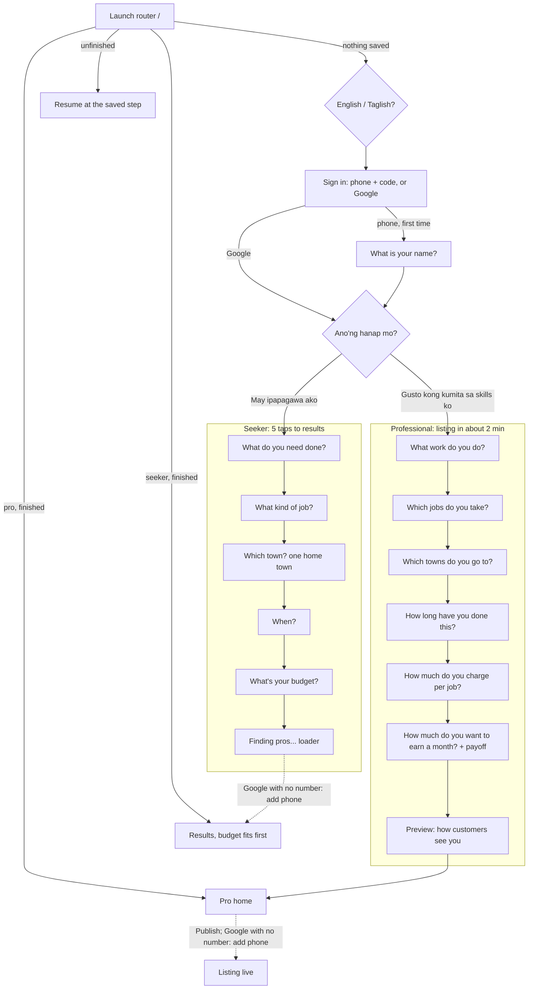

# Onboarding: Language, Sign In, then the Interview

> **Status:** Phase 1 is built (see §9). **Sign-in is now required before the app is used** (owner decision, 2026-11-11; §2.4): language → sign in → role → interview. The interview answers are still saved on the phone; listings, chats and reviews are in Azure SQL behind SideGigPh.Api ([`data-model.md`](data-model.md)).

**Supported towns (MVP)** (`ReferenceData.Cities`): **Angono · Antipolo · Taytay**, all in Rizal (`ReferenceData.ServiceAreaId`). With one area there is no province question: the area follows from the town. User-facing text calls the provider a **Skilled Worker**.

## 1. Decisions

| # | Decision | Why |
|---|----------|-----|
| 1 | **Sign in right after the language question.** `/` is a launch router; it sends anyone not signed in to `/verify`. | Owner decision: every API call needs a signed-in user, and a verified phone is how we keep listings honest (anti-fraud rule 1). The research below argues for later sign-in; it was weighed and overruled. |
| 2 | **First question: English or Taglish.** The screen itself shows both languages. | Many tradesmen aren't confident English readers. Language is the one question we can't phrase in "their" words yet, so it comes first. |
| 3 | **Second question: the role fork.** *"May ipapagawa ako"* (Seeker) or *"Gusto kong kumita sa skills ko"* (Professional). | A two-sided app has to know who it's talking to before anything can be personal. Fiverr asks this first too (§3.4). |
| 4 | **Onboarding is an interview.** One question per screen, big icon tiles, mostly one tap. | Short, easy questions build momentum, but only if the answers visibly come back (§3.2). |
| 5 | **Money is the hook on both sides.** The Seeker gives a budget for the job. The Professional gives a rate per job and a monthly earnings goal. | It's the real pain on both sides: households fear overpaying, pros want income. Both answers sit on **one shared price scale**, so they meet in the middle as "Pasok sa budget mo" (§2.3). |
| 6 | **Answers are saved on the phone, with no account.** They go through `IOnboardingStore`, backed by one JSON file in app-private storage. | It's free, works offline and survives restarts. It can move to the server later behind the same port (§6). |
| 7 | **Phone number + SMS code is the main sign-in; Google is below it.** A phone sign-in verifies the number and asks the name once. A Google sign-in brings the name, but must add a verified number before searching (Seeker) or publishing (Skilled Worker). | The listing number must be a number the worker proved they own, and nobody types their name or number twice. |

## 2. The flows


Dotted arrows: a Google account with no verified number adds one (`/verify/phone`, SMS code) before it continues.

### 2.0 Language (screen 1)
The title and subtitle are shown in both languages: **"Choose your language / Pumili ng wika"**. There are two tiles: **English** ("I'll read in English") and **Taglish** ("Tagalog na may halong English").

Copy rules for everything after this screen, because many readers aren't fluent in English:
- **Every tile has an icon.** Labels are a few words, and hints are short.
- **Numbers carry meaning:** peso amounts, years, towns. These read the same in both languages.
- **Service names stand on their own** ("Linis ng aircon", not just "Linis"). A tile then makes sense without its heading, and the same label drops cleanly into the pre-filled text message.
- **Taglish means everyday Taglish** ("Pa-freon ng aircon", "Nagca-canvass lang"), not formal Filipino.

### 2.1 Seeker interview (results in under 30 seconds)

| Step | Question (EN / Taglish) | Input | "Why we ask" | Answer reused at |
|------|--------------------------|-------|--------------|------------------|
| S1 | What do you need done? / Ano'ng ipapagawa mo? | 10 category tiles with icon and hint (aircon, tubero, electrician, bubong at alulod, karpintero, welder, mason & tiles, errands/PasaBuy, solar cleaning, home service massage) | none | Results chip, search |
| S2 | What kind of job? / Anong klaseng trabaho? | The category's jobs, most-requested first, ending with "Iba pa" | "So you only see pros who do exactly this." | Chip, ranking, **pre-filled text** |
| S3 | Where's the job? / Saan ang trabaho? | One home town: Angono · Antipolo · Taytay, stacked tiles (`TownPicker`, advances on tap; sets the area) | "See skilled workers near you." | Chip, search, pre-filled text |
| S4 | When do you need it? / Kailan mo kailangan? | Today (urgent) · This week · Nagca-canvass lang | "We'll tell the pro when you need it." | Chip, pre-filled text |
| S5 | What's your budget? / Magkano ang budget mo dito? | Price scale + "Di ko pa alam" | "Pros who fit your budget show up first." | Chip, **"Pasok sa budget mo"** badge and sort |

Then comes the **labor-illusion loader** (about 2 seconds): "Finding pros for Linis ng aircon ✓ · Checking who goes to Taytay ✓ · Putting pros in your budget first ✓".

**Results:**
- Answer chips at the top. Tapping one reopens that question, and the next pick returns straight to results.
- Pros in the budget come first, with a green badge.
- Each pro has **Call** and **Text** buttons. **Text opens the SMS app pre-filled:** *"Hi po! Nakita ko kayo sa SideGigPh. Kailangan ko po: Linis ng aircon, dito sa Taytay, ngayon. Available po ba kayo?"*
- **Cold start:** if no one serves the town, widen to the other served towns and say so. Never show an empty screen without a reason.

### 2.2 Professional interview (listing in about 2 minutes)

| Step | Question | Input | "Why we ask" | On the card / payoff |
|------|----------|-------|--------------|----------------------|
| P1 | What work do you do? / Ano'ng trabaho mo? | Multi-select categories | "Pick all that apply." | Trade line |
| P2 | Which jobs do you take? | Multi-select, grouped by trade | "Customers search for these exact jobs." | Job chips |
| P3 | Which towns do you go to? / Saang mga bayan ka pumupunta? | Multi-select Angono · Antipolo · Taytay (`TownPicker`: stacked tiles with checkboxes, "Select all"; sets the area) | "Customers in these towns see you first." | 📍 Goes to … |
| P4 | How long have you done this work? | <1 / 1–3 / 3–10 / 10+ years | "Customers look at this first." | Experience |
| P5 | **How much do you usually charge per job?** / Magkano ang singil mo kada trabaho? | Shared price scale + "Depende sa trabaho" | "Your starting price. You can still agree on the final price with the customer." | 💰 ₱500 – ₱1,000 per job |
| P6 | **How much do you want to earn each month?** / Magkano ang gusto mong kitain kada buwan? | ₱5k / ₱10k / ₱20k / ₱30k+ | "Just for you. This won't show on your listing." | 🎯 **"That's about 4 jobs a week at around ₱750 each. Let's get you there!"** |
| Preview | This is how customers will see you | Their card inside a mock search list, with the goal payoff | "Your listing, built from your answers." | "Ayos na 'to!" |

**Pro home** (Phase 1) shows the saved card, the goal with its payoff, and "Edit listing". It also says honestly: *"Saved on this phone. Not visible to customers yet."*

**Not in the interview:** work photos. They are added on Pro home or from the Me tab (`/professional/me/photos`), kept on the phone with a SHA-256 duplicate check (anti-fraud rule #2); upload to Azure Blob Storage through `SideGigPh.Api` comes with the cloud adapters (data-model step 5).

### 2.3 The money hooks: what was proposed, with three adjustments

The proposal: ask pros what they want to earn, and ask seekers their budget for the trade they picked. **That's right.** It's the actual pain point on both sides, and the two answers are the same number seen from two sides. Three adjustments make it work in practice:

1. **The seeker budget uses ranges plus "Di ko pa alam", and comes after the job type.** Most households don't know what a fair price is, and the price depends on the job (cleaning vs. installation). An open number field would stall people. Ranges anchor them, and "not sure" never blocks.
2. **The budget sorts and badges results; it doesn't filter them.** In a new directory, a hard filter turns into empty screens. "Pasok sa budget mo" pros come first, and everyone else still shows.
3. **The pro side asks two money questions.** The **rate** goes on the card, which is what seekers actually need to see. The **monthly goal** is the emotional hook, and it stays private. The app turns it into something concrete ("about 4 jobs a week") from the pro's own numbers. Nothing is invented, and this goal becomes the target Pro home can track later.

Both sides use **one price scale:** below ₱500 · ₱500–1,000 · ₱1,000–2,000 · ₱2,000–5,000 · ₱5,000+. A pro "fits" when their starting tier is at or below the seeker's budget tier.

**Guardrail: trust is the product.** No fake counters, no fake scarcity, no shaming copy. Every number shown is the user's own, or real data. Before launch the seeker results include **sample workers** from `SideGigPh.AzureSQL/Sql/002-seed.sql` (ids `seed-…`); its `DELETE` block removes them before go-live.

### 2.4 Sign-in (built)
- **Where:** right after the language question, before the role fork. `LaunchRouter` asks the skeleton `SignInGate`, which returns the missing step: `/verify` (sign in), `/verify/name` (name, once, after a phone sign-in), or `/verify/phone` (add a verified number, for pages that need one).
- **Methods:** phone number + SMS code first (it verifies the number), "Continue with Google" below.
- **Name and number are never asked in the interview.** The listing takes both from the account (`ListingMapper.TakeAccount`): the name from Google or the name screen, the number the account verified.
- **Pages that need a verified number:** Search results (`/seeker/search`) and Publish (`/professional/publish`). A Google account adds one there and comes back; the number is linked to the same account (`IIdentityProvider.LinkPhoneAsync`). If another account already has it, they are told to sign in with that number instead.
- **Anti-fraud rule 1:** Firebase Auth allows one account per number, the API takes the listing number from the token's verified number, and Azure SQL has a unique key on it.

## 3. What each reference contributes

### 3.1 UserOnboard: *Bulletproof User Onboarding* (Samuel Hulick)
<https://www.useronboard.com/bulletproof-user-onboarding/>

Users arrive with different intentions and different familiarity, so onboarding has to flex. It names three principles, each the opposite of a failure mode of tooltip tours ("Distracting, Controlling, Flaky"):

| Principle | Article's test | Applied |
|-----------|----------------|---------|
| **Integrated** | Onboarding should be "indistinguishable from the 'natural' product", not "an interface on top of your interface". | The interview *is* the product. Seeker answers become the search, and pro answers become the real listing card (the same `ProCard` that search results use). There are no coach marks, carousels or intro video. |
| **Empowering** | Is it "guiding users into actions that genuinely lead to progress in their lives, or just a better understanding of your UI?" | Every step moves toward a real outcome: a fixed aircon at a fair price, or the pro's monthly income goal. |
| **Steadfast** | Activation "can easily take days, if not weeks". | Onboarding continues on Pro home with the goal, and later a checklist, Level 2 and behavior-triggered push. |

It also endorses three patterns we use: empty states that give a reason plus a CTA, progression systems ("graduate them to Level 2"), and behavior-driven lifecycle messages.

### 3.2 Growth.Design case studies
<https://growth.design/case-studies>

None of the 52 studies is a two-sided services app. We took the principles from five of them: Grammarly onboarding survey, Headspace, Blinkist, Too Good To Go and Duolingo.

| Principle (site's name) | Lesson | Where it lives |
|---|---|---|
| **Spark Effect** (Grammarly) | Start with short, simple questions. | Language and role are one tap each, and every question is mostly tiles. |
| **Reciprocity: "When users give, they expect to get"** (Grammarly) | Questionnaires raise expectations, so show early that you listened. | The goal payoff right after P6, the answer chips on results, the pre-filled SMS. |
| **Personalization Clarity** (Grammarly, Blinkist) | Personalization done badly "can be worse than none". Never ask twice. | Every answer has a visible destination (the "reused at" columns). |
| **Respect > Data** (Blinkist) | "Build trust before you ask for data. And explain clearly why you need it." | The "Why we ask" line, the private-goal note, and auth only after the interview. |
| **Labor Illusion** (Headspace) | Visible effort raises perceived value, and spinners waste the moment. | The "Finding pros…" checklist loader. |
| **Tell → Show, Ask → Offer** (Too Good To Go) | Show the thing, and attach a benefit to every ask. | The pro preview shows the card inside a search list. Every ask comes with a benefit line. |
| **Endowment / IKEA Effect** (Headspace, Blinkist) | People value what feels like theirs. | The pro builds their own card before any auth ask. |
| **Investment right after a reward** (Duolingo) | "Right after a reward is the best moment to ask your user to invest." | Overruled for sign-in (it comes first now); still applies to the add-a-number step, which sits right after the loader peak and before Publish. |
| **Zeigarnik Effect** (Duolingo) | Unfinished tasks are remembered. | The exact step resumes after the app is killed. |
| **Hick's Law** (Duolingo) | More choices make decisions slower. | At most about 6 tiles per question. |
| **Exit points / no User Shaming** (Duolingo) | Let people leave cleanly. | "Di ko pa alam", "Depende sa trabaho", and back on every step. |
| **Positive framing** (Headspace) | Frame goals as benefits, not problems. | "Gusto kong kumita sa skills ko" and "Kaya natin 'yan!" |

### 3.3 Appcues: Really Good UX (GoodUX)
The given link (<https://www.appcues.com/reallygoodux>) returns **404**. The collection is at <https://goodux.appcues.com/>.

| Example | Pattern | Our use |
|---------|---------|---------|
| **DoorDash: "reveals value ahead of friction"** | Browse as a guest and sign up at checkout, because "It reveals the value of the app before subjecting the user to a necessary point of friction." | Our "checkout" is the auth gate after the interview. |
| **Thinkific: jump-in/jump-out checklist** | Only the critical jobs, with progress bars, and nothing forced. | The future Pro home checklist. |
| **Stellar: friendly new-user survey** | Most important questions first, because "people, they just want us to get started". It reported a 15% conversion lift. | Seeker: 5 taps. Pro: the questions that build the card come first, and photos are deferred. |
| **ClickUp mobile (critique)** | "Demonstrating value before asking for commitment", using "Realistic 'Dummy Data' instead of misleading 'Demo Data'". | The preview uses grey skeleton cards around the pro's card, not fake competitors. |

### 3.4 Page Flows: how top apps sequence it
<https://pageflows.com/>

Screens and video are paywalled, but the timestamped step lists are public.

| App (flow) | Observed order | Lesson |
|---|---|---|
| **Duolingo** (onboarding, 2023) | Language → reason → goal → **a real lesson** → **"Account unlocked"** → create profile | **Language first**, value before account. Both are in our flow. |
| **Fiverr** (onboarding, 2022) | **Select account type** → interests → sign up | Role first in a two-sided app. |
| **Uber Driver** (signup, 2019) | Choose city → vehicle? → *then* documents | Qualification (trade, towns) before paperwork. |
| **Airbnb** (listing a property, 2024) | ID check right before publishing | Verification belongs at publish, which is the pro auth gate. |
| **Uber rider, Grab, Headspace, Noom** | Account within the first 5–20 seconds | **Deliberately not copied.** They're household names; we have to earn the ask. |

Thumbtack, TaskRabbit, Upwork and Carousell weren't reachable on Page Flows. They're worth checking by hand.

## 4. Screen rules (every interview step)

1. One question per screen. Tiles first, typing last.
2. Single-choice questions advance on tap. Multi-choice questions and text fields have a sticky **Next** (Tuloy) button.
3. Show a "Why we ask" line whenever the reason isn't obvious.
4. **Save whenever the user moves forward** (a single tap, or Next). A killed app resumes at the step they were on.
5. **Each step has its own URL** (`/start/seeker/3`), so Android hardware back walks the steps. The on-screen back button does the same.
6. The progress bar starts partly filled (Endowed Progress). It has no "n of N" text.
7. The same components as the real product: the preview card *is* the search-result card.
8. Mobile-first, MudBlazor components with theme colors only (`AppTheme`), and every string is bilingual (§5).

## 5. Implementation (Phase 1, as built)

### Routes
| Route | Component | Role |
|-------|-----------|------|
| `/` | `Onboarding/LaunchRouter` | Loads `IOnboardingStore`, applies the language and redirects to `/start`, `/start/role`, the resume step, `/seeker` or `/professional`. |
| `/start` | `Onboarding/LanguagePage` | English / Taglish. |
| `/start/role` | `Onboarding/RolePage` | Seeker / Professional fork. |
| `/start/seeker/{step?}` | `Onboarding/SeekerInterview` | S1–S5, plus the loader at step 6. |
| `/start/pro/{step?}` | `Onboarding/ProfessionalInterview` | P1–P6 (P3a is its own step), plus the preview at step 8. |
| `/seeker` | `Seeker/SeekerHome` | Seeker home in the shared `AppShell` (top bar + tabs Home, Inbox, Me): dense search box, town menu, trade icon rail, last search, recent messages. |
| `/seeker/search` | `Search/SearchPage` | Free-text or tapped search, job chips, town/budget filters; ranked results grouped by town. The Seeker interview lands here. |
| `/pro/{id}` | `Search/PublicProfilePage` | A pro's public profile with a pinned Contact button. |
| `/inbox` · `/inbox/{id}` | `Inbox/InboxPage` · `Inbox/ThreadPage` | Contacted pros; the thread has a ready message, Send text and Call. |
| `/me` · `/me/reviews` · `/me/reviews/rate/{id}` | `Seeker/*Page` | The Me tab (`SeekerMePage`: name, Your reviews link, language, Start over), the Seeker's reviews and pros to rate, and writing a review. |
| `/professional` | `Professional/ProfessionalHome` | Pro home in the shared `AppShell` (via `ProLayout`): setup checklist, recent inquiries, latest reviews, the goal. |
| `/professional/inquiries` · `/reviews` · `/me` · `/me/photos` | `Professional/*Page` | The other tabs. Me (`ProMePage`, also the avatar) has the photo, listing, work photos, language and Start over. |
| `/professional/publish` | `Professional/PublishPage` | Card + pledge, then publish (one number, one listing). |
| `/verify` | `Auth/AuthPage` (skeleton) | Sign in: phone + SMS code, Google below. Shown by `LaunchRouter` to anyone not signed in. |
| `/verify/name` | `Auth/NamePage` (skeleton) | First + last name, once, after a phone sign-in. |
| `/verify/phone` | `Auth/AddPhonePage` (skeleton) | Adds a verified number to a Google account, before Search results or Publish. |

### Components
- **Shared (generic):** `InterviewStep` (back, progress, title, why, note, sticky Next), `ChoiceTiles` (single/multi icon tiles), `WorkingLoader` (labor illusion), `ProCard`, `GoalPayoff`, `MePage` (+ `LanguagePicker`, `StartOverCard`).
- **Onboarding:** `LaunchRouter`, `LanguagePage`, `RolePage`, `SeekerInterview`, `ProfessionalInterview`, `ListingPreview`.
- **Layout:** `AppShell` (`AppTopBar`, `AppBottomNav`, `AppNavItem`), used by `ProLayout` and `SeekerLayout`.
- **Search:** `SearchPage`, `SearchBox`, `ChipStrip`, `FilterMenu`, `ResultGroup`, `ResultCard`, `PublicProfilePage` (`FilterMenu` is in Shared); ranking in `Services/Search`.
- **Inbox:** `InboxPage`, `ThreadPage`, `ThreadRow`, `ContactBubble`, `MessageComposer`.
- **Seeker:** `SeekerLayout`, `SeekerHome`, `CategoryRail`, `LastSearchCard`, `SeekerReviewsPage`, `ToRateRow`, `WriteReviewPage`, `SeekerMePage`.

### Text and reference data
- `Services/Localization/AppText`: a singleton holding the chosen language. Use `T.Get(text)` and `T.Format(text, args)`.
- `Services/Localization/Copy`: **every UI string** as a `LocalizedText(English, Taglish)` pair, side by side, so the Taglish copy can be reviewed in one file.
- `Services/ReferenceData`: categories and jobs, towns, urgency, experience, the shared price scale and income goals, all bilingual.

### Ports
- `IOnboardingStore` → `Local/FileOnboardingStore` (JSON, source-generated serializer, atomic write).
- `IContactLauncher` → `Local/DeviceContactLauncher` (MAUI `PhoneDialer` / `Sms`; the Android manifest declares the `tel`/`smsto` intent queries).
- `IProfessionalProfileRepository.SearchAsync` → `Api/ApiProfessionalProfileRepository` (`GET professionals?categoryId=…&areaId=…` on SideGigPh.Api, Azure SQL).

## 6. Where answers live on the phone

### 6.1 No cookies: what a MAUI app uses
Blazor Hybrid code runs as **native .NET**, not in a browser. The WebView's `localStorage` exists, but only through JS interop. It is wiped with the WebView's data and can't be reached by C# services.

| Need | MAUI API | Android / iOS | Use for |
|------|----------|---------------|---------|
| Small flags | `Preferences` | SharedPreferences / NSUserDefaults | Tiny independent flags (none yet) |
| A document | JSON file in `FileSystem.AppDataDirectory` | App-private files | **The interview state** (`onboarding.json`) |
| Photos | Files in `AppDataDirectory/photos` | App-private files | The pro's own and work photos, named by their SHA-256 |
| Secrets | `SecureStorage` | Keystore / Keychain | Nothing yet. Firebase keeps its own session. |
| Queryable data | SQLite (`sqlite-net-pcl`) | — | **Later:** favorites, recently viewed, offline cache |
| Server cache | — | — | **Later:** recent listings and chats for offline use |

**No SQLite yet.** Onboarding is one document, read at launch and written on every answer. Add SQLite when local data needs *querying*. Android Auto Backup (`allowBackup="true"`) restores the file after a reinstall.

### 6.2 The port
```csharp
public interface IOnboardingStore
{
    Task<OnboardingState> LoadAsync();   // a new, empty state when nothing is saved
    Task SaveAsync(OnboardingState state);
}
```

### 6.3 Anonymous session (considered, not used: everyone signs in first)
These are verified in the packages already referenced:
- `Plugin.Firebase.Auth` 3.1.1: `SignInAnonymouslyAsync()`, `IFirebaseUser.IsAnonymous`, `LinkWithPhoneNumberVerificationCodeAsync(code)`.
- `Plugin.Firebase.Auth.Google` 3.1.2: `LinkWithGoogleAsync()`.

A silent anonymous session at launch gives a UID for API calls and App Check without a login screen. At the gate, linking the phone or Google credential keeps the same UID. It needs **Anonymous** enabled in the Firebase console.

### 6.4 Anti-fraud tie-ins
- **Rule 1:** enforced **server-side** when a pro goes live, keyed by E.164 phone (and later the GCash number). The local draft is never trusted for this.
- **Rule 2:** compute SHA-256 when a photo is picked (later), and re-check on the server at upload.

## 7. What to measure
- Drop-off per step, for both interviews and the language and role screens.
- **Seeker activation:** the first Call/Text tap. Also time from launch to results, and the share of results that fit the budget.
- **Pro activation:** preview confirmed (later, listing live). Also drafts left unfinished, and the distribution of rates and goals per trade and town. That last one is real data for the seeker's price hints.

## 8. Open questions
1. **Edit name:** a Skilled Worker's listing shows the account name. A shop name ("Mang Jun Aircon Services") needs an edit-name option on the Me page.
2. **Monetization:** subscription, boost or lead fees? This decides when GCash is collected.
4. **Barangay-level location:** needs an authoritative barangay list (PSGC) for the 3 towns.
5. **Non-trade pros** (web dev, video editing): needs an "Other" path with free text.
6. **Per-service town coverage:** today a pro's towns apply to all their services. If pros need "I do installs only in Taytay", coverage has to move to each service (and later to barangays).
7. **Category count (10 and growing):** past about 10 tiles, S1 should show popular categories first with a "More" option, or add search (Hick's Law).
8. **Viber / Messenger** contact buttons, alongside Call and Text.

## 9. Build order
1. ✅ **Phase 1 (local-first interview):** language, role, both interviews, the money hooks, the store, sample-data results with Call/Text, the pro preview and home. `AuthPage` moved to `/verify`.
2. **Phase 2:** ✅ sign-in first (phone + Google, name, verified-number gate); in-app chat, listings and search on Azure SQL through SideGigPh.Api with the server-side anti-fraud checks, work photos.
3. **Phase 3 (Steadfast):** Pro home checklist and Level 2, progress toward the earnings goal, share links (Facebook/Messenger), review prompts, behavior-triggered push.
